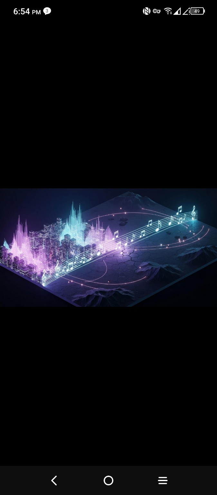

# Music World

**Turn any song into a living 3D world you can explore in the browser or in VR on Meta Quest.**

Notes slide along a glowing musical staff, fall onto the terrain and build a neon city in sync with the music. An AI
world director (Meta Muse or Claude on Amazon Bedrock) reads the song's harmony, energy and lyrics and designs the
world as a template. Anyone can publish templates in a community store.

> Built with [Kiro](https://kiro.dev) for **Kiroween 2026** (category: Frankenstein).
> Status: **early development** — design, specs and agent setup are in place; application code starts now.



## How it works

```text
Audio upload ─► Python analysis (Demucs, Basic Pitch, librosa) ─► notes, chords, tempo, key, energy, lyrics
            ─► AI World Director (Muse / Claude) ─► validated world template (data only)
            ─► Next.js + IWSDK ─► deterministic world engine driven by the audio clock ─► browser / Meta Quest
```

- Algorithms detect the notes; the LLM only interprets the mood and designs the world.
- The world is a pure function of playback time: pause, seek and replay always show the exact same world.
- Templates and AI output are validated data, never executed code.

## Stack

Next.js · TypeScript · IWSDK (Three.js, WebXR) · IWER · FastAPI · Python (Demucs, Basic Pitch, librosa) ·
PostgreSQL · Redis · OVHcloud (Docker Compose, Object Storage) · Meta Model API (Muse) · Amazon Bedrock (Claude).

## Built with Kiro

- **Specs** — `.kiro/specs/` (requirements in EARS format, design, tasks)
- **Steering** — `.kiro/steering/rules.md` is the single source of project rules for every agent
- **Skills** — `.kiro/skills/` · **Custom agents** — `.kiro/agents/` · **Hooks** — `.kiro/hooks/`
- **Handoff between agents** — `docs/handoff.md`
- Full log: [`KIRO_USAGE.md`](KIRO_USAGE.md)

## Documentation

- Design document (French): [`PROJECT.md`](PROJECT.md)
- Current status and next steps: [`docs/handoff.md`](docs/handoff.md)

## Development setup

Requirements: Python 3.12 via [uv](https://docs.astral.sh/uv/), Node 22+ with pnpm, Docker (for `make dev`).

```bash
cd apps/api && uv sync && cd ../..   # Python deps
pnpm install                          # web app + schema generator
make schemas                          # pydantic -> JSON Schema -> TS + zod
make check                            # lint + types + tests + architecture check
pnpm -C apps/web dev                  # http://localhost:3000/play/demo (IWER emulates a Quest 3 in dev)
                                      # demo: space = play/pause, arrows = seek ±5 s
```

Full stack in Docker (Caddy, web, api, worker, postgres, redis):

```bash
make dev                              # then open https://localhost/play/demo (accept the local certificate)
curl -k https://localhost/api/health  # {"status":"ok",…}
```

`make help` lists every target. Production settings: copy `infra/.env.example` to `infra/.env`.

## License

[MIT](LICENSE)
